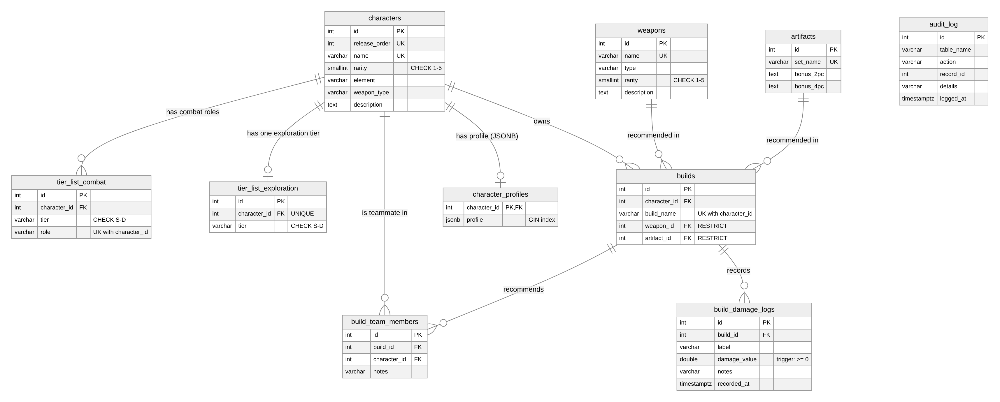

# Codex - Game Companion Database (DBMS PBL Project)

A web application and PostgreSQL database that organises game-companion data: characters, weapons, artifact sets, combat and exploration tier lists, recommended builds with teammates, and per-build damage logs with graphs. The dataset is Genshin Impact themed (fan-made, educational, no game assets, not affiliated with the publisher). The database is hosted on **Neon** (cloud PostgreSQL).

> Course: DBMS - LCA3 / CCA3 Project-Based Learning

## Team Members
| Role | Name | Roll Number |
|---|---|---|
| Member A (database, backend, cloud, dashboard / damage lab / SQL explorer) | `<NAME A>` | `<ROLL NO A>` |
| Member B (front-end pages, documentation, presentation) | `<NAME B>` | `<ROLL NO B>` |

## Problem Statement
Game data is scattered across wikis, videos and spreadsheets, is inconsistent and goes stale. A relational database can answer questions such as *"which build of this character deals the most damage, and with which teammates?"* Full statement and objectives: [docs/problem_statement.md](docs/problem_statement.md).

## Tech Stack
| Layer | Technology |
|---|---|
| **Database** | **PostgreSQL 16** on **Neon** (cloud), JSONB, views, function, procedure, triggers, indexes |
| Backend | Python 3.10+, Flask 3, Flask-SQLAlchemy, Flask-CORS, psycopg2, python-dotenv, matplotlib |
| Frontend | HTML5, CSS3, vanilla JavaScript (ES modules), Chart.js |
| Testing / CI | pytest, GitHub Actions |
| Tools | VS Code, Git/GitHub, Neon SQL Editor |

## Features
* CRUD for characters, weapons, artifact sets, tiers and builds with filters and search
* S-to-D tier board (combat roles and exploration)
* Build recommendations with teammates (many-to-many)
* Damage Lab: log damage through a **stored procedure**, see PNG graphs, "best build" from a **SQL function**
* Dashboard with charts, SQL Explorer (views, function, JSONB filter, demo queries, audit log)
* Database-level rules: CHECK constraints, validation **trigger**, audit **trigger**

## Database Design
* 10 tables in 3NF/BCNF: `characters`, `weapons`, `artifacts`, `tier_list_combat`, `tier_list_exploration`, `builds`, `build_team_members`, `build_damage_logs`, `character_profiles` (JSONB), `audit_log`
* **ER diagram:** [docs/er_diagram.md](docs/er_diagram.md) 
* **Normalisation:** [docs/normalization.md](docs/normalization.md)
* **Advanced SQL** ([sql/04_advanced_pg.sql](sql/04_advanced_pg.sql)): 3 views, 1 function, 1 procedure, 2 triggers, 4 indexes
* **Demo queries** ([sql/05_queries.sql](sql/05_queries.sql)): joins, GROUP BY/HAVING, subqueries, JSONB, transaction

## UN SDG Mapping
Primary **SDG 9** (Industry, Innovation and Infrastructure) and secondary **SDG 4** (Quality Education). Details: [docs/sdg_mapping.md](docs/sdg_mapping.md).

## Setup / Execution Instructions
Prerequisites: Python 3.10+, Git, VS Code, a free Neon account (or any PostgreSQL database).

1. **Clone** and open in VS Code
   ```
   git clone <REPO URL>
   cd <REPO FOLDER>
   code .
   ```
2. **Virtual environment and packages** (VS Code terminal)
   ```
   python -m venv venv
   venv\Scripts\activate          # macOS/Linux: source venv/bin/activate
   pip install -r requirements.txt
   ```
3. **Database:** create a Neon project, copy its connection string, then `copy .env.example .env` (macOS/Linux: `cp`) and paste it as `DATABASE_URL`. See [docs/cloud_deployment.md](docs/cloud_deployment.md).
4. **Create tables and load data** (run in this order)
   ```
   python scripts/run_sql.py sql/01_schema_pg.sql sql/02_seed_data.sql sql/03_seed_extra.sql sql/04_advanced_pg.sql
   ```
5. **Run the app**
   ```
   python app.py
   ```
   Open http://127.0.0.1:5000 (site) and http://127.0.0.1:5000/api/health (should say `"database": "connected"`).
6. **Run the tests** (optional): `pip install -r requirements-dev.txt` then `pytest -q`

## Project Structure
```
├── app.py                  Flask backend (config, models, routes, graphs)
├── requirements.txt / requirements-dev.txt
├── .env.example            template (the real .env is never committed)
├── sql/                    01_schema_pg, 02_seed_data, 03_seed_extra, 04_advanced_pg, 05_queries, legacy_mysql/
├── scripts/run_sql.py      runs .sql files against DATABASE_URL
├── tests/test_api.py       pytest API tests
├── docs/                   ER diagram, normalisation, SDG, problem statement, cloud deployment, viva Q&A, screenshots
├── presentation/           slides
└── app/static/             website: index.html, css/, js/ (main.js router, api.js, ui.js, theme.js, views/)
```

## API Overview
All paths start with `/api`.
| Resource | Endpoints |
|---|---|
| Characters, weapons, artifacts | `GET/POST /characters`, `GET/PUT/DELETE /characters/<id>` (same for `/weapons`, `/artifacts`) |
| Tiers | `GET/POST /tier-lists/combat`, `/tier-lists/exploration`, `DELETE .../<id>` |
| Builds | `GET/POST /builds`, `GET/PUT/DELETE /builds/<id>`, `POST /builds/<id>/team` |
| Damage | `GET/POST /damage-logs`, graph PNGs `/damage-logs/graph/build/<id>`, `/damage-logs/graph/compare/<character_id>` |
| SQL objects | `/views/<name>`, `/best-build/<id>`, `POST /procedures/add-damage-log`, `/profiles`, `/audit-log`, `/demo-queries` |
| Misc | `/analytics/summary`, `/search?q=`, `/health` |

## Screenshots
Add screenshots to `docs/screenshots/` and link them here: dashboard, tier board, damage lab, SQL explorer.

## Limitations and Honesty Notes
* Damage values in `sql/03_seed_extra.sql` are **sample data**, not measured results.
* Fan-made educational project; no game assets; not affiliated with the publisher.
* No user accounts; the API is open (suitable for a demo, not production).

## Development Notes
Parts of the code and documentation were produced with AI assistance and then reviewed, tested and adapted by the team. <!-- keep this line only if your teacher allows AI tools; otherwise delete it -->
