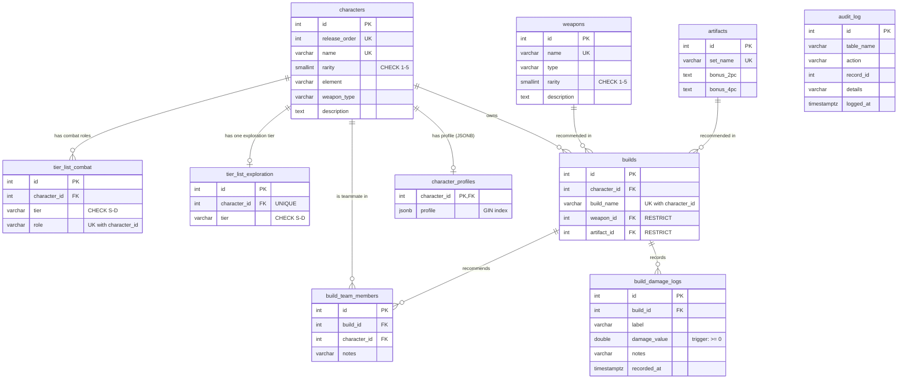

# ER Diagram

Rendered automatically by GitHub (Mermaid). A PNG copy is in `er_diagram.png`.

`audit_log` has no foreign keys on purpose: it is filled by the trigger `audit_characters` and must keep its rows after a character is deleted.

## Relationships

| Relationship | Cardinality | On delete |
|---|---|---|
| characters - tier_list_combat | 1 : N | CASCADE |
| characters - tier_list_exploration | 1 : 1 | CASCADE |
| characters - builds | 1 : N | CASCADE |
| weapons - builds | 1 : N | RESTRICT (a weapon used by a build cannot be deleted) |
| artifacts - builds | 1 : N | RESTRICT |
| builds - build_team_members - characters | M : N through a junction table | CASCADE |
| builds - build_damage_logs | 1 : N | CASCADE |
| characters - character_profiles | 1 : 1 | CASCADE |
